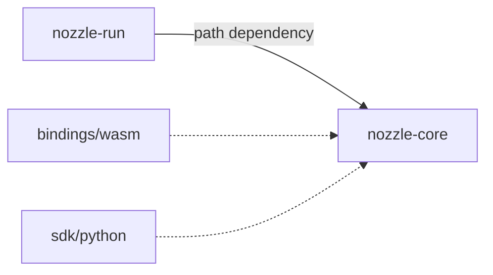

## The crate graph

```text
cargo workspace (root Cargo.toml)
├─ core/    package nozzle-core    — pure scheduling logic
└─ runner/  package nozzle-run     — path-depends on core

bindings/wasm  (wasm-pack builds; excluded from the workspace)
sdk/python     (maturin builds;     excluded from the workspace)
```

The root manifest is tiny and says everything:

```toml
[workspace]
members = ["core", "runner"]
exclude = ["bindings/wasm", "sdk/python"]
```

Both binding packages manage their **own** build flows and versioning
(`wasm-pack build`, `maturin develop`), so they live outside the workspace
instead of sharing its lockfile.



Solid edge: a workspace path dependency. Dotted edges: the two out-of-workspace
binding packages, which compile against `nozzle-core` but manage their own
builds and versioning. Those bindings are the seed of the multi-language
story: the YAML runner, a future Python SDK, and a future JS/TS SDK all
compile onto the same [`WorkflowSpec`](/docs/dev/spec-model) — the core never
knows which frontend produced a graph.

## The core's module inventory

Six modules, each with a one-paragraph doc comment stating its contract:

| Module | Contains | Answers |
|---|---|---|
| `dag` | `WorkflowSpec`, `TaskSpec`, `Edge`, `Predicate`, `validate()` | Is this graph well-formed? |
| `readiness` | `TaskView`, `Readiness`, `readiness()`, `next_ready()` | May this queued task start now? |
| `states` | `RunStatus`, `TaskStatus` | What life-cycle stage is a run/task in? |
| `xcom` | `classify()`, `Classification`, `PlacementError`, `content_hash()` | Where does this output belong? |
| `refs` | `PlacementPolicy`, `OutputRef` | Who promised an output, under what policy? |
| `config` | `Defaults` | What are the tuned knobs' default values? |

The hard rule: **nothing in `core` performs I/O.** No `std::fs`, no
`std::process`, no `std::net`. That is why the same six modules compile to a
wasm-bindgen shim and a PyO3 shim with zero API drift — the binding crates
attach to stable, side-effect-free functions.

### Who decides what

```text
┌──────────────────────────────┬────────────────────┐
│ question                     │ answered by        │
├──────────────────────────────┼────────────────────┤
│ is the graph valid?          │ core::dag          │
│ may this task start?         │ core::readiness    │
│ does this output fit inline? │ core::xcom         │
│ spawn sh, capture, inject    │ runner::scheduler  │
│ format output, exit codes    │ runner::main       │
└──────────────────────────────┴────────────────────┘
```

Every runner "decision" is a translation, not a policy. The runner never
couples [ordering shortcuts](/docs/dev/runner#the-loop) and never second-guesses the core's answers.

## The two-layer data split (the important idea)

The engine understands a workflow as **two maps**:

```text
        core's world                     runner's world
┌────────────────────────────┐   ┌───────────────────────────────┐
│ WorkflowSpec               │   │ BTreeMap&lt;String, TaskDef&gt;   │
│   id, language             │   │   id → cmd (the shell string) │
│   tasks = names + runtimes │   │   id → env bindings           │
│   edges = who feeds whom   │   └───────────────────────────────┘
└────────────────────────────┘
```

The core sees a name-annotated graph; the runner separately remembers the
executable world keyed by the same names. Commands never cross the boundary.
That is what makes the core embeddable — a future orchestrator that executes
tasks in containers would supply its own table, and the graph semantics stay
identical.

## Test matrix

| Layer | Where | What it covers |
|---|---|---|
| unit | in each core module | validation rules, readiness cases, classification |
| unit | in `runner/src` | YAML parsing, mapping, trimming, placement |
| integration | `runner/tests/run_test.rs` | whole-pipeline scenarios incl. the built binary |
| binding smoke | `just test-wasm` | Node smoke test of the wasm surface |
| binding pytest | `just test-py` | maturin wheel + pytest of the PyO3 surface |
| end to end | `just run-demo` | random docker image built through the engine |

All green is the definition of done for any change here; `just test` runs the
first three layers in one command.
