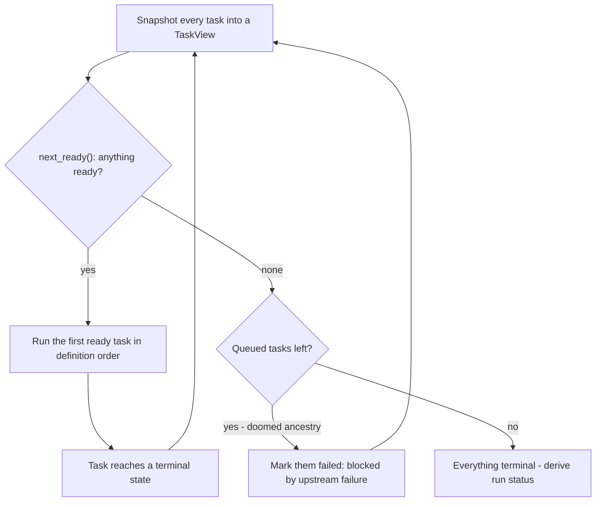

## The loop

The runner executes at most **one task at a time**, in this cycle:

1. Snapshot the current state of every task into `TaskView`s (the core's
   input format).
2. Ask the core's `next_ready` which queued tasks may start.
3. If any are ready, take the **first in definition order** and run it (spawn,
   capture, transition to a terminal state).
4. Goto 1 until every task is terminal.

Two consequences follow from picking the *first* ready task in definition
order and running it to completion: execution is deterministic given the same
YAML and the same outputs, and there is never concurrency.



## States

Per-task lifecycle (from the core's `states` module):

```text
   queued ──► running ──► succeeded
                 │
                 └───────► failed
```

`skipped` also exists in the core (branch predicates) but is unreachable from
YAML, which has no predicates yet. The run's own status is derived at the end:
`succeeded` iff **every** task succeeded, otherwise `failed`.

## Failure behavior

When a task fails (non-zero `sh` exit, or its output is oversized):

- The task is marked `failed` with a note (`exit status 3` or the size error).
- Its downstream is **never executed**. It drains as `failed` with the note
  `blocked by upstream failure` once no ready work remains.
- Independent branches keep running. A task with no path to the failure is
  still `ready` on later loop iterations, and runs to success.
- The run ends `FAILED`; the process exits `1`.

```yaml
name: partial-success
tasks:
  - id: a
    cmd: exit 3          # fails
  - id: b
    cmd: ok
    needs: [a]           # blocked, never executed
  - id: c
    cmd: ok              # independent: still runs, still succeeds
```

Results in: `a` failed, `c` succeeded, `b` failed (blocked by upstream
failure), run failed, exit 1.

## Why the loop terminates

After the YAML is validated there are no cycles and no predicates, so the
only unready shape is "some ancestry is doomed or pending". Pending ones
eventually run; doomed ones meet the drain rule (`next_ready` empty + queued
left ⇒ mark them failed). Every pass replaces at least one `queued` with a
terminal state, or terminates the loop — so it always ends.

## The size guard

Before a captured value is handed to a downstream variable, the runner asks
the core to classify it with the `auto` placement policy against the inline
threshold, **64 KiB by default**:

- under the threshold → the value goes through as `inline`,
- at or over it → the producing task **fails its attempt** with
  `output of N bytes exceeds inline-only threshold of 65536 bytes`.

Nothing is truncated, quoted, or base64-shrunk: if a value cannot honestly
flow, the workflow stops. A task without downstream bindings is exempt —
verbose stdout nobody consumes is harmless.

<Callout type="warn" title="No retries">
  A failed task stays failed. The core config carries a `max_attempts` knob
  (default 3) from a future orchestration layer, but the runner loop never
  consults it: attempts == 1 for now.
</Callout>

## Where exactly each behavior lives

| Behavior | Decided by | Code |
|---|---|---|
| Is the graph valid | core | `core/src/dag.rs`, `validate()` |
| May this task start now | core | `core/src/readiness.rs`, `next_ready()` |
| Does this output fit | core | `core/src/xcom.rs`, `classify()` |
| Spawn, capture, inject | runner | `runner/src/scheduler.rs`, `LocalExecutor::execute()` |
| Drain blocked tasks | runner | `runner/src/scheduler.rs`, the `None` arm of the loop |

This split is why the runner is ~230 lines: it runs off four core functions.
The [code walkthrough](/docs/dev/architecture) shows each one.
