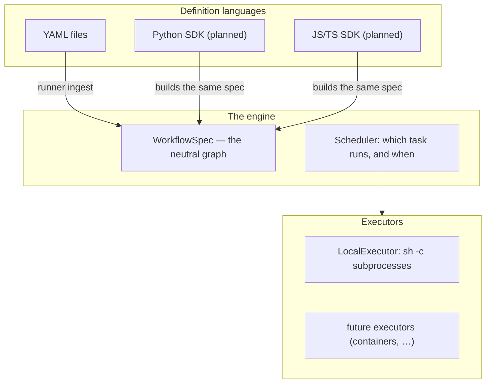

Nozzle is a **workflows-as-code scheduling engine**. A workflow declares shell
commands with dependencies, and the engine runs them in dependency order,
piping each task's captured stdout into downstream environment variables.

The design goal is bigger than YAML: **one engine, many definition languages,
pluggable executors.** YAML is the first and current definition language;
Python and JS/TS frontends are planned. What makes that possible is a strict
layering that this documentation follows everywhere.

## The layers

1. **Definition languages** produce a `WorkflowSpec` — a language-neutral
   graph of tasks and edges — plus a table of commands. YAML files are parsed
   by the runner's ingest layer today; the Python and JS/TS SDKs will build
   the same spec programmatically.
2. **The engine** (`nozzle-core`) is pure scheduling logic over that spec:
   graph validation, readiness decisions, output placement. It contains zero
   file, process, or network APIs, so it does not know or care which language
   the workflow was written in.
3. **Executors** decide *how* a single task runs. The scheduler decides
   *which* task runs *when* and hands each task to an `Executor` — today a
   `LocalExecutor` that spawns `sh -c` subprocesses; tomorrow, other
   backends behind the same trait.

Because the spec is the contract between layers, a workflow's meaning is
identical no matter which frontend produced it — and executors can be swapped
without touching a workflow.

## What ships today

| Piece | Status | Where |
|---|---|---|
| YAML definition language | shipped | `runner/` ingest — see [Writing YAML workflows](/docs/guide/workflows/yaml) |
| `nzl` CLI (`run`, `schema`) | shipped | see [CLI reference](/docs/reference/cli) |
| Scheduler core (graph, readiness, placement) | shipped | `nozzle-core` — see [Developer's Guide](/docs/dev/architecture) |
| Local process executor | shipped | `LocalExecutor` |
| Python SDK | planned | `sdk/python/` PyO3 surface exists for the core |
| JS/TS SDK | planned | `bindings/wasm/` wasm-bindgen surface exists for the core |
| Remote/container executors | planned | the `Executor` seam |

The binding packages are the seed of the multi-language story: they already
expose the same core functions to Python and TypeScript that the CLI uses.
The SDKs will assemble `WorkflowSpec`s and drive the same scheduling logic —
the docs mark everything that depends on them as *planned* until it ships.

## Design principles

1. **The core makes decisions, the runner does I/O.** Every semantic
   question — is this graph valid, may this task start, does this output fit
   inline — is answered by a pure core function. Everything effectful
   (processes, environment variables, exit codes) lives in the runner.
2. **The spec is the contract.** Definition languages map onto the spec
   without leaking into it — commands never enter the core. See
   [The spec model](/docs/dev/spec-model).
3. **Failure is honest.** Tasks print lifecycle lines, the run summary names
   every task, oversized outputs fail their producing task rather than
   truncate, and the process exits zero only if every task succeeded.

<Callout type="info" title="Engineering-first">
  Nozzle's users are engineers, and the documentation treats them that way:
  every claim links to the file or test that backs it. Start with
  [Getting started](/docs/guide/getting-started) or go straight to the
  [Developer's Guide](/docs/dev/architecture).
</Callout>
